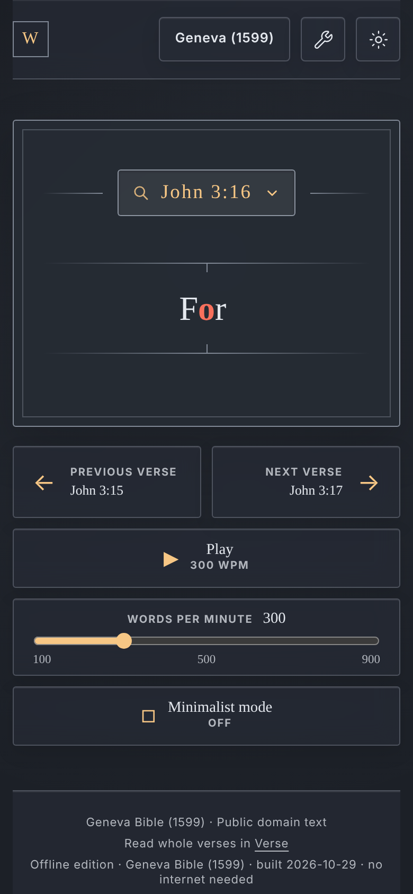

<div align="center">

# Word

**Scripture one word at a time.**
A Bible speed reading app: each word with a red focus letter, at the speed you choose, in your browser, even with no internet.

### ⬇ Download for offline use

### [Geneva 1599](https://github.com/elcafe7/word/releases/latest/download/word-geneva1599.html) · [KJV](https://github.com/elcafe7/word/releases/latest/download/word-kjv.html) · [KJV 1611](https://github.com/elcafe7/word/releases/latest/download/word-kjv1611.html)

<sub>one HTML file per Bible · about 4.3 MB each · free · <a href="https://github.com/elcafe7/word/releases/latest">release page</a></sub>

[**Read online**](https://apocalypse.press/word/) · [Verse](https://apocalypse.press/verse/) · [Scroll](https://apocalypse.press/scroll/)

[](LICENSE)

<sub>A project of <a href="https://jesuspeoplesf.com">Jesus People SF</a> &amp; <a href="https://apocalypse.press">Apocalypse Press</a> · <a href="https://jesuspeoplesf.com/donate/">Donate</a></sub>



</div>

---

## What it is

Word flashes the Bible one word at a time in the middle of your screen, so your eyes stay still and you can read steadily without losing your place. Press play, set a pace that feels comfortable, and read.

- **Three Bibles:** Geneva Bible (1599), King James Version (Oxford 1769), and King James Version (1611 original).
- **Your pace:** from 100 to 900 words per minute, in small steps.
- **Easy to steer:** go back a verse, jump to any passage, or press and hold to pick a word.
- **Minimalist mode** and **light or dark**.

## Read online

Open **[apocalypse.press/word](https://apocalypse.press/word/)** in any browser, on a computer or a phone. Nothing to install, always up to date.

## Download for offline use

Each Bible is **one HTML file**. Download it once, then open it any time with no internet and nothing to install.

1. **Download** the Bible you want:
   - [**Geneva Bible (1599)**: `word-geneva1599.html`](https://github.com/elcafe7/word/releases/latest/download/word-geneva1599.html) (about 4.3 MB)
   - [**King James Version (Oxford 1769)**: `word-kjv.html`](https://github.com/elcafe7/word/releases/latest/download/word-kjv.html) (about 4.3 MB)
   - [**King James Version (1611 Original)**: `word-kjv1611.html`](https://github.com/elcafe7/word/releases/latest/download/word-kjv1611.html) (about 4.4 MB)
2. **Double-click the file.** It opens in Chrome, Edge, Safari, or Firefox. There's nothing to unzip.
3. **Press play.** It works with no internet connection.

Each file has the 66 books of the Old and New Testaments (no Apocrypha). All three files and their checksums are also on the [release page](https://github.com/elcafe7/word/releases/latest).

**On a phone?** The easiest way is to read online at [apocalypse.press/word](https://apocalypse.press/word/), and you can add it to your home screen from your browser's Share or menu button. To use the downloaded file on a phone, see **Android** and **iPhone / iPad** below.

## Opening the file

### Mac
Double-click the file. It opens in Safari (or your default browser). Chrome, Edge and Firefox work too.

### Windows
Double-click the file. It opens in Edge (or your default browser). Chrome and Firefox work too.

### Android
1. Download the file in Chrome.
2. Open the **Files** app, then **Downloads**, and tap the file.
3. Choose **Chrome**, then **Just once**.

If it opens in "HTML Viewer", nothing will play. Open it again and pick Chrome.

### iPhone / iPad
An iPhone or iPad can't run a web page saved on the device by itself (tapping the file only shows a still preview), so use the free **Koder** app:

1. Install **[Koder Code Editor](https://apps.apple.com/us/app/koder-code-editor/id1447489375)** from the App Store (free).
2. In Safari, tap the link for your Bible in the list above, then tap **Download**. It saves to **Files › Downloads**.
3. Open the **Files** app, go to **Downloads**, long-press the file, tap **Share**, and choose **Koder** (or open Koder and import the file from Files).
4. In Koder, tap the file, then tap **Preview** to run Word.

Or skip the download and read online at **[apocalypse.press/word](https://apocalypse.press/word/)**.

## Controls

| Action | Keyboard | Touch |
|---|---|---|
| Play / pause | <kbd>Space</kbd> | Tap the word |
| Previous verse | <kbd>←</kbd> | Swipe right |
| Next verse | <kbd>→</kbd> | Swipe left |
| Faster / slower (steps of 25, 100–900 words per minute) | <kbd>↑</kbd> / <kbd>↓</kbd> | Drag the words-per-minute slider |
| Hold and scrub | — | Press and hold the word, drag left or right to pick a word, then let go to continue from there |
| Go to a passage | <kbd>/</kbd> | Tap the reference (e.g. **John 3:16**) |
| Minimalist mode | <kbd>M</kbd> | **Minimalist mode** button |
| Light / dark | <kbd>T</kbd> | **Sun** button |
| Close a panel | <kbd>Esc</kbd> | — |

<kbd>←</kbd> goes back to the start of the current verse first, then to the verse before. Reading rolls on from the end of a chapter into the next one.

## Your place is saved

Each file remembers your book, chapter, verse, word, speed and theme in that browser, so it opens where you left off. The address bar also shows your verse, so a bookmark brings you back there.

## Check your download (optional)

Download `SHA256SUMS` into the same folder as the file, then run this in that folder:

**Mac** (replace `word-kjv.html` with your file)
```sh
grep word-kjv.html SHA256SUMS | shasum -a 256 -c
```

**Linux**
```sh
sha256sum -c --ignore-missing SHA256SUMS
```
You should see `OK` on Mac or Linux.

**Windows (PowerShell)** (replace `word-kjv.html` with your file)
```powershell
Get-FileHash .\word-kjv.html -Algorithm SHA256
```
Compare the hash with the line for that file in `SHA256SUMS` (capital letters don't matter).

## More from us

- [Verse](https://apocalypse.press/verse/): read whole verses, with Hebrew and Greek source text. Also [downloadable for offline use](https://github.com/elcafe7/verse).
- [Scroll](https://apocalypse.press/scroll/): the Bible rolling gently up your screen. Also [downloadable](https://github.com/elcafe7/bible_scroller).
- [Apocalypse Press](https://apocalypse.press) · [Jesus People SF](https://jesuspeoplesf.com) · [Donate](https://jesuspeoplesf.com/donate/)

## License

The code is under the [MIT License](LICENSE). The Bible texts are public domain.

---

## For developers

You only need this to change the app. To read, use the download above.

### Build from source

Needs Node 22 and Python 3.

```sh
npm ci
npm run data             # public/data/ from data/bible_versions/{kjv,kj16,gen}.db (or set WORD_DB_DIR)
npm test
npm run build            # dist/, served under /word/
npm run offline          # release/word-offline-<YYYYMMDD-HHMM>/: the three HTML files, SHA256SUMS, release notes
```

The Bible databases in `data/bible_versions/` are the same files as in [Verse](https://github.com/elcafe7/verse).

#### Tests

```sh
npx playwright install
npm run e2e                                              # online app, local server
WORD_OFFLINE_DIR=release/word-offline-<YYYYMMDD-HHMM> npm run e2e:offline   # the HTML files from file://, no network
```

---

<div align="center"><sub>Bible texts: Geneva Bible (1599), King James Version (Oxford 1769) and King James Version (1611 Original), all public domain.</sub></div>
