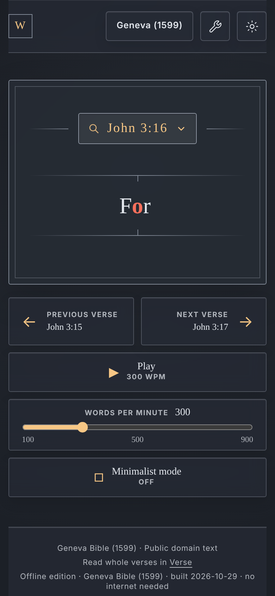

<!-- STAGED DRAFT for elcafe7/word (not published). Tag offline-20261029 and sizes filled from the 2026-10-29 16:22 ET build.
     UNVERIFIED: the Koder steps 3-4 button names (Share -> Koder, Preview) until the iPhone test I3. -->

<div align="center">

# Word

**Scripture one word at a time.**
A red focus letter, at the speed you choose, in your browser, even with no internet.

[**Read online**](https://apocalypse.press/word/) · [**Download offline**](#download-offline) · [Verse: whole verses](https://apocalypse.press/verse/)

<sub>A project of <a href="https://jesuspeoplesf.com">Jesus People SF</a> &amp; <a href="https://apocalypse.press">Apocalypse Press</a></sub>



</div>

---

## Download offline

Each Bible is **one HTML file**. Download it once, then open it any time with no internet and nothing to install on a computer or Android phone.

| Bible | File | Size |
|---|---|---|
| **Geneva Bible (1599)** | [`word-geneva1599.html`](https://github.com/elcafe7/word/releases/download/offline-20261029/word-geneva1599.html) | ~4.3 MB |
| **King James Version (Oxford 1769)** | [`word-kjv.html`](https://github.com/elcafe7/word/releases/download/offline-20261029/word-kjv.html) | ~4.3 MB |
| **King James Version (1611 Original)** | [`word-kjv1611.html`](https://github.com/elcafe7/word/releases/download/offline-20261029/word-kjv1611.html) | ~4.4 MB |

All three files and [`SHA256SUMS`](https://github.com/elcafe7/word/releases/download/offline-20261029/SHA256SUMS) are on the [**offline-20261029 release page**](https://github.com/elcafe7/word/releases/tag/offline-20261029). Each file has the 66 books of the Old and New Testaments (no Apocrypha).

## Open it

### Mac
Double-click the file. It opens in Safari (or your default browser), and Chrome, Edge and Firefox work too.

### Windows
Double-click the file. It opens in Edge (or your default browser), and Chrome and Firefox work too.

### Android
1. Download the file in Chrome.
2. Open the **Files** app, then **Downloads**, and tap the file.
3. Choose **Chrome**, then **Just once**.

If it opens in "HTML Viewer", nothing will play. Open it again and pick Chrome.

### iPhone / iPad
iPhone can't run web pages saved on the phone by itself (tapping the file only shows a still preview), so use the free **Koder** app:

1. Install **[Koder Code Editor](https://apps.apple.com/us/app/koder-code-editor/id1447489375)** from the App Store (free).
2. In Safari, open the download link for your Bible and tap **Download**, or **Share → Save to Files**.
3. Open the **Files** app, long-press the file, tap **Share**, and choose **Koder** (or open Koder and import the file from Files).
4. In Koder, tap the file, then tap **Preview** to run Word.

Or skip the download and read online at **[apocalypse.press/word](https://apocalypse.press/word/)**.

## Controls

| | Keyboard | Touch |
|---|---|---|
| Play / pause | <kbd>Space</kbd> | Tap the word |
| Previous verse | <kbd>←</kbd> | Swipe right |
| Next verse | <kbd>→</kbd> | Swipe left |
| Faster / slower (steps of 25, 100–900 words per minute) | <kbd>↑</kbd> / <kbd>↓</kbd> | Drag the words-per-minute slider |
| Hold and scrub | — | Press and hold the word, drag left or right to pick a word, then let go to continue from there |
| Go to a passage | <kbd>/</kbd> | Tap the reference (e.g. **John 3:16**) |
| Minimalist mode | <kbd>M</kbd> | **Minimalist mode** button |
| Light / dark | <kbd>T</kbd> | **Sun** button |
| Close a panel | <kbd>Esc</kbd> | — |

<kbd>←</kbd> goes back to the start of the current verse first, then to the verse before. Reading rolls on from the end of a chapter into the next one.

## Your place is saved

Each file remembers your book, chapter, verse, word, speed and theme in that browser, so it opens where you left off. The address bar also shows your verse, so a bookmark brings you back there.

## Verify your download (optional)

Download `SHA256SUMS` into the same folder as the file, then:

**Mac** (replace `word-kjv.html` with your file)
```sh
grep word-kjv.html SHA256SUMS | shasum -a 256 -c
```

**Linux**
```sh
sha256sum -c --ignore-missing SHA256SUMS
```

**Windows (PowerShell)** (replace `word-kjv.html` with your file)
```powershell
Get-FileHash .\word-kjv.html -Algorithm SHA256
```
Compare the hash with the line for that file in `SHA256SUMS`. You should see `OK` on Mac or Linux.

## Build from source

Needs Node 22 and Python 3.

```sh
npm ci
npm run data             # public/data/ from data/bible_versions/{kjv,kj16,gen}.db (or set WORD_DB_DIR)
npm test
npm run build            # dist/, served under /word/
npm run offline          # release/word-offline-<date>/: the three HTML files, SHA256SUMS, release notes
```

The Bible databases in `data/bible_versions/` are the same files as in [Verse](https://github.com/elcafe7/verse).

### Tests

```sh
npx playwright install
npm run e2e                                              # online app, local server
WORD_OFFLINE_DIR=release/word-offline-<date> npm run e2e:offline   # the HTML files from file://, no network
```

## License

The code is under the [MIT License](LICENSE). The Bible texts are public domain.

## Also from Apocalypse Press

- **[Word online](https://apocalypse.press/word/)**: the same reader, always up to date.
- **[Verse](https://apocalypse.press/verse/)**: read whole verses, with Hebrew and Greek source text. Its offline build: [Verse offline-20261023](https://github.com/elcafe7/verse/releases/tag/offline-20261023).

---

<div align="center"><sub>Bible texts: Geneva Bible (1599), King James Version (1611 Original) and King James Version (Oxford 1769), all public domain.</sub></div>
